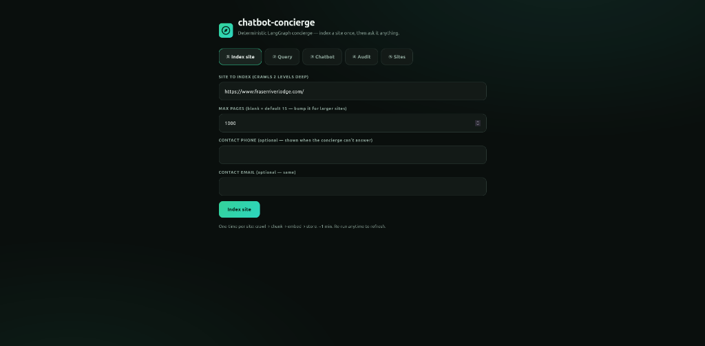
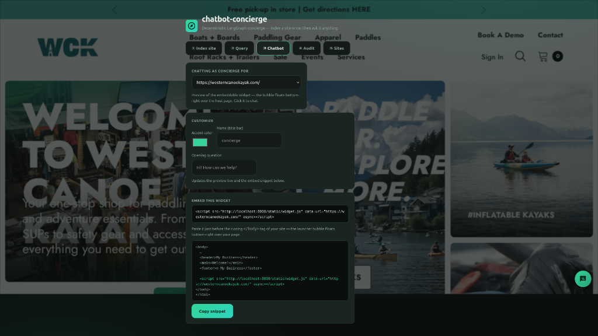
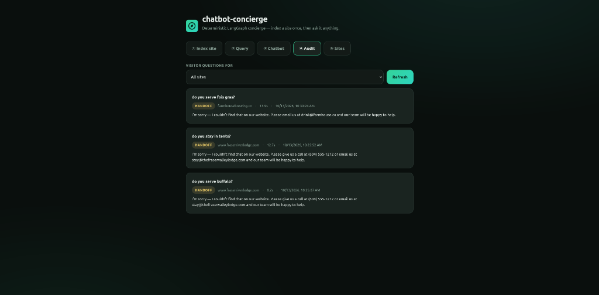

# concierge

Self-contained dev/demo stack in one `docker compose up`: **Ollama** (local
LLM + embeddings), **Firecrawl** (self-hosted web-scraping API, wired to use
the project's Ollama for its LLM features), and a **LangGraph chatbot concierge** — a
deterministic, checkpointed state machine that pipelines scrape → chunk →
embed → retrieve → answer over those two services. Firecrawl brings its own
internal Playwright render backend, so JavaScript-heavy pages work with no
extra setup.

Everything runs from published images — no host installs of ollama, node,
playwright, or firecrawl are used. To move to a VPS, copy this repo, set
`.env`, and run the same command. All state lives in named volumes.

## Screenshots



*① Index site — one-time map → curate → scrape → chunk → embed → store per
site, with optional contact info used in handoff replies and a per-run page
limit.*



*③ Chatbot — preview of the embeddable widget: a launcher bubble floats
bottom-right over the host page and opens the concierge popup.*



*④ Audit — every visitor question logged with its outcome (grounded /
handoff / error), latency, answer, and sources; filterable per site and
exportable to PDF (`audit-{domain}-{YYYY-MM}.pdf` via `GET /audit/pdf`).*

## Quick start

```bash
cp .env.example .env        # required — compose has no built-in fallbacks
docker compose up -d
```

First boot pulls images (~4 GB) and then the ollama models
(~5 GB: `llama3.1:8b` + `nomic-embed-text`). Watch progress with
`docker compose logs -f ollama-pull`.

## Endpoints

| Service   | Local URL                   | Notes                          |
| --------- | --------------------------- | ------------------------------ |
| Ollama    | `http://localhost:11435`    | OpenAI-compat at `/v1`         |
| Firecrawl | `http://localhost:3002`     | `POST /v2/scrape`, `/v2/map`, `/v2/batch/scrape` |
| Chatbot concierge | `http://localhost:8000`     | Demo UI at `/`, API at `/docs` |

> **Port note:** a host-installed Ollama typically owns `localhost:11434`.
> This project's container publishes on **11435** so the two never conflict.
> Inside the compose network, services always reach it at
> `http://ollama:11434` regardless of the published port. If you deploy to a
> VPS with no host ollama, set `OLLAMA_PORT=11434` in `.env`.

## Smoke tests

```bash
# Ollama is serving + models are pulled
curl http://localhost:11435/api/tags

# Firecrawl scrape → markdown
curl -s -X POST http://localhost:3002/v2/scrape \
  -H "content-type: application/json" \
  -d '{"url":"https://example.com","formats":["markdown"]}'

# Chatbot concierge: index a site once (slow, ~1 min), then query it fast forever
curl -s -X POST http://localhost:8000/index \
  -H "content-type: application/json" \
  -d '{"url":"https://example.com"}'
curl -s http://localhost:8000/sites

curl -s -X POST http://localhost:8000/query \
  -H "content-type: application/json" \
  -d '{"url":"https://example.com/","question":"What is this domain used for?"}'
curl -s http://localhost:8000/runs/<run_id>

# Full containerized test suite (no host tooling needed)
docker compose --profile test run --rm e2e
```

## Architecture

```
┌─────────────┐
│ ollama      │ ◄────── http://ollama:11434 (+ OpenAI-compat /v1)
│ llama3.1:8b │
│ nomic-embed │
└──────┬──────┘
       │ OLLAMA_BASE_URL (firecrawl's LLM features point here)
┌──────┴───────────┐
│ firecrawl-api    │ :3002 — REST API (harness runs api+workers)
│  ├─ firecrawl-   │      page-render microservice (its own playwright
│  │  playwright   │      browsers; handles JS-heavy pages)
│  ├─ firecrawl-   │      redis — BullMQ/rate limiting
│  │  redis        │
│  ├─ firecrawl-   │      rabbitmq — Nuq job queue
│  │  rabbitmq     │
│  └─ firecrawl-   │      nuq postgres — job/crawl state
│     postgres     │
└────────┬─────────┘
         │ FIRECRAWL_URL
┌────────┴─────────┐
│ chatbot-concierge│ :8000 — two checkpointed LangGraph workflows:
│ index: map →     │      index (map→scrape→chunk→embed→store) builds a
│ chunk → embed →  │      persistent corpus per site; query
│ store            │      (load→retrieve→answer) reuses it — no
│ query: load →    │      re-crawl per question. Demo UI at /.
│ retrieve → answer│      Tune via CHATBOT_CONCIERGE_CRAWL_LIMIT /
└──────────────────┘      _MAP_LIMIT / _TIMEOUT env vars.
```

There is no standalone Playwright service — `firecrawl-playwright` is
Firecrawl's internal render backend, required for JS-rendered scraping and
not published to the host. If you later need to drive a browser from your
own code, add a `launch-server` service to this compose file (that pattern
was used here previously; see git history).

## Usage snippets

Ollama chat (OpenAI-compatible):

```bash
curl http://localhost:11435/v1/chat/completions -d '{
  "model":"llama3.1:8b",
  "messages":[{"role":"user","content":"hello"}]}'
```

Firecrawl scrape:

```bash
curl -X POST http://localhost:3002/v2/scrape \
  -H "content-type: application/json" \
  -d '{"url":"https://example.com","formats":["markdown"]}'
```

## Environment

See `.env.example` — model names, published ports, firecrawl concurrency.
GPU: the `ollama` service has a commented `deploy` block for NVIDIA
reservations (needs `nvidia-container-toolkit` on the host).

## Production / VPS notes

- All published ports bind to `127.0.0.1` — put a reverse proxy in front
  and keep it that way, or firewall the ports.
- `USE_DB_AUTHENTICATION=false` means **Firecrawl has no API key** — fine on
  the compose bridge/localhost, not acceptable exposed to the internet.
- The chatbot-concierge API has no auth either — same rule. Don't publish `:8000`
  without a proxy layer.
- Set a real `FC_POSTGRES_PASSWORD` before deploying.
- Backup: `docker run --rm -v concierge_ollama-models:/v alpine tar cf - /v`
  (same pattern for `fc-pg-data`, `fc-redis-data`, `chatbot-concierge-data`).

## Limits

- `ollama-pull` re-checks models on every `up` (idempotent; seconds when
  already pulled). Change models in `.env`.
- Firecrawl self-host lacks the cloud "fire-engine" — no managed
  anti-bot/proxy layer. Respect target sites' terms.
- Image tags `latest` are used for ollama/firecrawl for dev convenience;
  pin digests for a reproducible VPS deployment.
