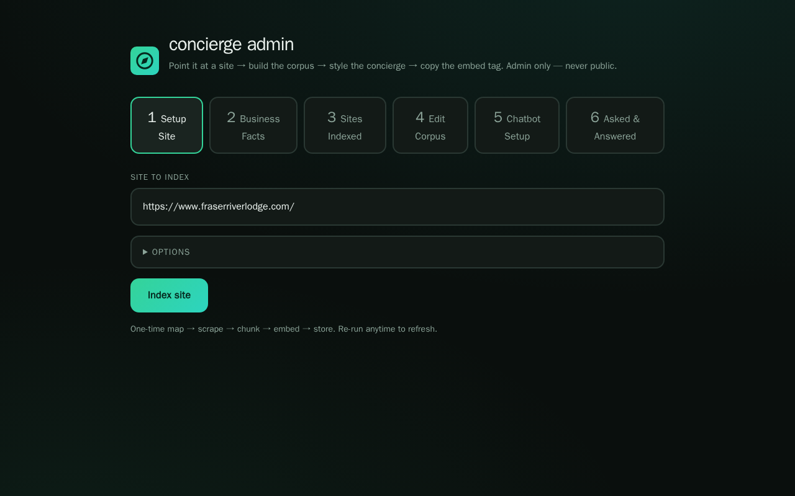
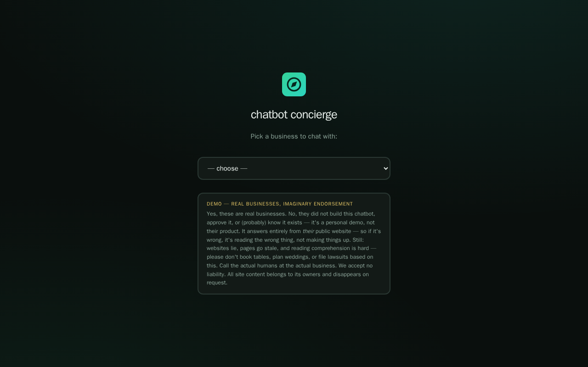
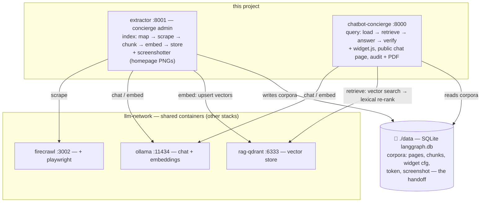

# concierge

Two deployables in one repo, sharing one corpus DB:

- **`chatbot-concierge`** (public, :8000) — a deterministic, checkpointed
  LangGraph service that pipelines load → retrieve → answer → verify over a
  persistent per-site vector store. It serves the embeddable widget
  (`static/widget.js` — launcher bubble + popup in a shadow root, immune to
  host-page CSS) and a public chat page where visitors pick an indexed
  business from a dropdown (or deep-link `/?token=WORD`). **Query-only** —
  it can never crawl, pick, or re-index, so the deployed knowledge store
  can't be modified by visitors.
- **`extractor`** (admin — `admin` compose profile, :8001, branded
  "concierge admin", never public) — the admin UI + corpus builder: map a
  site via firecrawl + playwright, auto-pick the useful pages, screenshot
  the homepage, chunk → embed → store. Also where the admin reads the
  business's facts, edits the corpus, styles the widget, and copies the
  embed tag.

Both talk to shared infrastructure on the `llm-network` docker network:
`ollama` for chat + embeddings and `firecrawl` (+ `firecrawl-playwright`)
for extraction — this project runs none of them itself.

The corpus is the handoff between them: extractor writes the `corpora`
table (SQLite `langgraph.db` in the `./data` bind mount); concierge reads
it. Build corpora where the admin stack runs, deploy the concierge where
visitors are.

## Screenshots



*concierge admin (:8001) — six tabs: index a site, read its facts, manage
indexed corpora, edit pages, style the widget, review asked & answered.*



*chatbot concierge (:8000) — visitors pick an indexed business and chat
with its widget.*

## concierge admin (:8001) — the tabs

1. **Setup Site** — URL + options (page limit, contact phone/email, tz)
   → one-time index run with a live step trace (map → scrape → chunk →
   embed → store).
2. **Business Facts** — pick an indexed site → `GET /business-facts`
   extracts what the concierge knows straight from the stored corpus
   (no rescrape; same text the chatbot answers from).
3. **Sites Indexed** — corpus list: page/chunk counts, token, crawl tree,
   reindex, delete.
4. **Edit Corpus** — pick a corpus → its crawled pages listed as links;
   `✕` drops a page and its chunks (`DELETE /sites/page`), keeping
   embeddings aligned.
5. **Chatbot Setup** — per-site widget styling (accent colour, name,
   greeting, "show contact info in header" toggle) and the embed tag to
   paste on the client's site: `<script src="PUBLIC_CHATBOT_URL
   /static/widget.js?token=WORD" async></script>`. The public concierge
   URL is deployment config (`PUBLIC_CHATBOT_URL`), not admin input.
6. **Asked & Answered** — every visitor question with its outcome
   (grounded / handoff / error), latency, answer, sources; filterable per
   site, exportable to PDF (`GET /audit/pdf`).

Tabs 2-6 stay disabled until a corpus exists.

## Public chat page (:8000)

Dropdown of indexed businesses → selecting one loads that site's widget
(bubble bottom-right) over a faded homepage screenshot
(`GET /sites/screenshot?token=`). `?token=` deep-links still work. A
demo disclaimer sits on the page — edit it in
`apps/chatbot-concierge/static/index.html`.

## Quick start

```bash
cp .env.example .env        # required — compose has no built-in fallbacks
docker compose up -d                          # public side only
docker compose --profile admin up -d          # everything incl. admin stack
```

**Prereq:** the `llm-network` docker network must exist with shared
`ollama` and `firecrawl` (+ `firecrawl-playwright`) containers already
running — extractor reaches them over the network gateway, this project
runs none of them itself. The models named in `.env` must already be
pulled on that ollama:

```bash
docker network create llm-network   # once, if it doesn't exist yet
docker exec ollama ollama pull qwen3:14b
docker exec ollama ollama pull nomic-embed-text
```

## Endpoints

| Service   | Local URL                   | Notes                          |
| --------- | --------------------------- | ------------------------------ |
| Ollama (shared) | `http://localhost:11434` | container `ollama` on `llm-network`; OpenAI-compat at `/v1` |
| Firecrawl (shared) | `http://localhost:3002` | container `firecrawl` on `llm-network` — extractor calls `http://firecrawl:3002` |
| Chatbot concierge | `http://localhost:8000`  | public chat page at `/`, API at `/docs` |
| Concierge admin | `http://localhost:8001`  | admin UI at `/` — `admin` profile only, never public |
| Cloudflare tunnel | `*.trycloudflare.com` | publishes :8000 publicly — URL in `docker logs concierge-tunnel` |

> **Network note:** both services reach Ollama and Firecrawl inside docker
> as `http://ollama:11434` / `http://firecrawl:3002` on `llm-network`.
> Whatever publishes those APIs on the host is the shared stack's business
> — this project doesn't publish them.

## Smoke tests

```bash
# Shared ollama is serving + the required models are pulled
curl http://localhost:11434/api/tags

# Admin: index a site once (~1-2 min) — map → scrape → chunk → embed → store
curl -s -X POST http://localhost:8001/index \
  -H "content-type: application/json" \
  -d '{"url":"https://example.com"}'
curl -s http://localhost:8001/sites

# Admin: what the corpus knows (no rescrape)
curl -s "http://localhost:8001/business-facts?url=https://example.com/"

# Concierge: ask the corpus — needs the site's widget token (shown by
# /sites, also embedded in the widget tag); unindexed sites fail cleanly
curl -s -X POST http://localhost:8000/query \
  -H "content-type: application/json" \
  -d '{"url":"https://example.com/","question":"What is this domain used for?","token":"WORD"}'
curl -s http://localhost:8000/runs/<run_id>

# Full containerized test suite (no host tooling needed)
docker compose --profile test run --rm e2e
```

## Architecture



## Knowledge base: who writes the corpus

The `corpora` table in `./data/langgraph.db` (SQLite, bind mount) is
the contract. **Extractor** writes one row per site through its index
workflow; **concierge** only reads it — plus the `widget` column, which the
admin sets from the admin UI and the concierge serves to the widget:

| Column        | Contents                                              |
| ------------- | ----------------------------------------------------- |
| `url`         | corpus key — canonicalized to a trailing-slash origin |
| `title`       | site title                                            |
| `pages`       | JSON `[{url, title}]` — drives the Edit Corpus list   |
| `chunks`      | JSON `[{text, source}]`                               |
| `embeddings`  | JSON `[[float, …]]` — positional with `chunks`, `nomic-embed-text` |
| `phone`/`email` | optional contact details — header opt-in + handoff replies |
| `token`       | widget key — `/query` rejects mismatched tokens       |
| `screenshot`  | homepage PNG captured during indexing                 |
| `tz`          | business-local IANA zone for "tonight"-class questions |
| `widget`      | JSON theming `{name, greeting, colour, contact}`      |
| `indexed_at`  | unix timestamp                                        |

`widget.contact` is an opt-in flag: when set, `/widget-config` also
returns the corpus's phone/email and the widget shows them in its header.

## Environment

See `.env.example` — model names, published ports, `PUBLIC_CHATBOT_URL`
(the concierge's public URL baked into embed tags; dev default
`http://localhost:8000`). Ollama and Firecrawl live outside this project
(shared containers on `llm-network`); their config, GPU/device setup, and
auth belong to whichever stack owns them.

## Production / VPS notes

- All published ports bind to `127.0.0.1` — put a reverse proxy in front
  and keep it that way, or firewall the ports.
- The concierge API has no auth — the widget is meant to be reachable
  cross-origin; gate the admin surface (`/sites`, `/audit`, `/runs`) at the
  proxy instead.
- **Never run `--profile admin` in production.** The admin UI is
  build-time tooling; deploy the concierge alone and ship the corpus data
  to it — and set `PUBLIC_CHATBOT_URL` to the real public origin.
- The `tunnel` service runs a quick tunnel by default (random
  `trycloudflare.com` URL, changes every restart — get it from
  `docker logs concierge-tunnel`). For a stable hostname, create a
  named tunnel in Cloudflare Zero Trust, set `CF_TUNNEL_TOKEN` in `.env`,
  and switch the compose command to `tunnel run --token ${CF_TUNNEL_TOKEN}` —
  then point `PUBLIC_CHATBOT_URL` at that hostname for correct embed tags.
- `llm-network` with reachable `ollama` + `firecrawl` containers is a hard
  dependency — create the network and run/point at them before `up`.
- Backup: `tar cf - data/` — it's a plain directory on the host.

## Limits

- The models named in `.env` must exist on the shared `ollama` container —
  this stack doesn't pull them. Change models in `.env` and pull them
  there (`qwen3:14b` chat + `nomic-embed-text` embeddings by default).
- The shared ollama's default context is ~4k tokens — extraction calls
  cap their input accordingly. Bigger `num_ctx` on that container lets
  `/business-facts` read more of a corpus at once.
- qwen3 thinking is disabled via `think: false` on chat calls — keeps
  reasoning out of `content` and off the latency path.
- Embeddings must match between the two services — if you change
  `OLLAMA_EMBED_MODEL`, rebuild the affected corpora.
- SQLite is a single-writer store: the shared volume copes because
  extractor's writes are rare and admin-driven — don't point many concierge
  replicas at one file.
